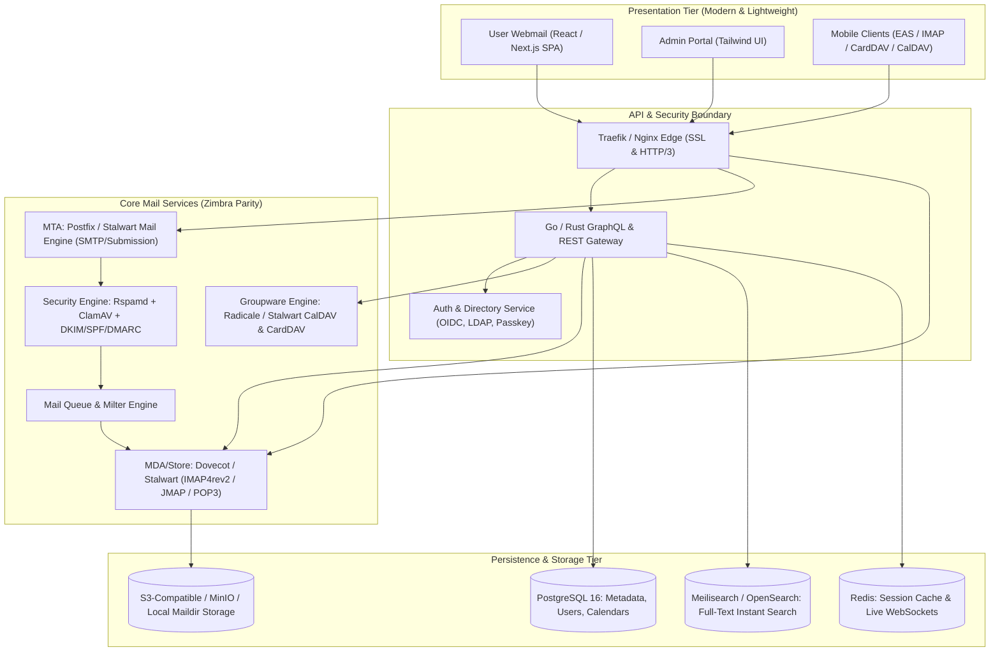
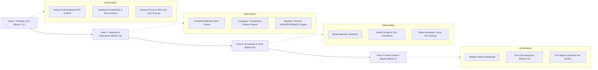

# PRODUCT REQUIREMENT DOCUMENT (PRD)
## ApexMail Collaboration Suite
**A Modern, Clean, and Functional Alternative to Zimbra Mail Server**

---

| **Dokumen** | **Detail** |
|---|---|
| **Versi Dokumen** | 1.0.0 |
| **Status** | Draft Ready for Review |
| **Target Rilis** | Q1-Q2 Roadmap |
| **Kategori Produk** | Enterprise Mail Server & Groupware Suite |
| **Filosofi Desain** | Friendly, Professional, Light/Bright Minimalist, Functional First |

---

## 1. Executive Summary & Visi Produk

### 1.1 Latar Belakang
Zimbra Collaboration Suite (ZCS) telah lama menjadi standar industri untuk platform email dan kolaborasi mandiri (*self-hosted*). Namun, seiring berjalannya waktu, Zimbra memiliki beberapa kelemahan mendasar:
- **Tampilan UI Ketinggalan Zaman:** Antarmuka visual yang padat, penuh dengan toolbar bertingkat, ikon-ikon kecil yang membingungkan, dan pengalaman pengguna (*UX*) yang kaku.
- **Konsumsi Sumber Daya Tinggi:** Berbasis stack Java monolitik berat yang membutuhkan alokasi RAM dan CPU besar hanya untuk *idle*.
- **Kompleksitas Administrasi:** Panel admin yang terpecah dan kurva belajar yang curam bagi administrator baru.

### 1.2 Visi Produk: ApexMail
**ApexMail** dirancang untuk menghadirkan seluruh keandalan dan kapabilitas email server kelas enterprise setara Zimbra (Mail, Calendar, Contacts, Tasks, Drive/Briefcase, Admin Multi-Domain), namun dibungkus dalam **desain antarmuka modern, cerah (*light/bright theme*), elegan, bersih, dan ringkas**. 

Fokus utama adalah membuang redundansi tombol/ikon navigasi, mengutamakan *whitespace* yang nyaman di mata, tipografi hierarkis yang jelas, serta performa UI yang instan (di bawah 100ms) tanpa mengorbankan fungsionalitas enterprise sedikit pun.

---

## 2. Prinsip Desain UI/UX (Clean, Bright & Zero-Bloat)

Untuk memenuhi kebutuhan *tampilan yang friendly, profesional, cerah, tidak banyak icon atau tombol yang tidak perlu, serta seringkas mungkin namun fungsional*, ApexMail menerapkan pedoman desain berikut:

```
┌────────────────────────────────────────────────────────────────────────┐
│  PRINSIP DESAIN APEXMAIL                                               │
├────────────────────────────────────────────────────────────────────────┤
│ 1. Zero Visual Bloat      : Sembunyikan aksi sekunder; tampilkan hanya │
│                             saat dibutuhkan (Contextual Actions).      │
│ 2. Bright & High Clarity  : Latar putih bersih (#FFFFFF), abu-abu      │
│                             lembut (#F8FAFC), dan aksen Indigo/Biru.   │
│ 3. Keyboard-First & Speed : Command Palette (Ctrl+K) untuk aksi cepat  │
│                             tanpa membebani layar dengan tombol.       │
│ 4. Clear Typography       : Font modern (Inter / Plus Jakarta Sans)    │
│                             dengan hierarki kontras yang tajam.        │
│ 5. 3-Pane Responsive Grid : Folder -> Daftar Pesan -> Baca Pesan.      │
└────────────────────────────────────────────────────────────────────────┘
```

### 2.1 Palet Warna & Visual Identity
- **Background Utama:** `#FFFFFF` (Panel baca/tulis) & `#F8FAFC` (Sidebar & list container).
- **Border & Pembatas:** `#E2E8F0` (Garis tipis 1px halus, menghindari garis tebal kaku).
- **Warna Teks Primer:** `#0F172A` (Slate gelap untuk keterbacaan optimal).
- **Warna Teks Sekunder:** `#64748B` (Muted gray untuk timestamp, status, metadata).
- **Brand Accent:** `#2563EB` (Royal Blue) atau `#4F46E5` (Indigo) — memberikan kesan terpercaya, profesional, dan berenergi cerah.
- **Badge Status:** Hijau lembut (`#ECFDF5`), Amber (`#FFFBEB`), Merah (`#FEF2F2`) dengan teks berwarna senada.

### 2.2 Eliminasi Tombol Tak Perlu (Anti-Zimbra Bloat)
| UI Zimbra Lama | Pendekatan Baru ApexMail |
|---|---|
| Puluhan ikon toolbar di atas daftar email (Forward, Reply, Print, Spam, Tag, dll) | **Contextual Floating Bar**: Toolbar hanya muncul saat email dipilih atau di-hover. |
| Menu navigasi berlapis tab bertumpuk (Mail, Address Book, Calendar, Tasks, Preferences) | **Slim Left Icon-Nav**: Bilah navigasi vertikal tipis (56px) di sisi paling kiri dengan tooltip elegan. |
| Modal popup dialog bertumpuk untuk compose email | **Floating Docked Drawer**: Composer mengambang di pojok kanan bawah yang bisa di-minimize/expand tanpa menutupi layar baca. |
| Ikon-ikon dekoratif tanpa label jelas | **Label teks ringkas & ikon mikro bergaris halus (Lucide Icons 1.5px stroke)**. |

---

## 3. Arsitektur Solusi & Komponen Sistem

ApexMail menggunakan arsitektur modular yang decoupled antara *Mail Core Engine* dan *Modern Web Client/API Gateway*.



---

## 4. Rincian Modul & Fungsionalitas (Paritas Penuh Fitur Zimbra)

### 4.1 Modul 1: Email (Webmail Modern)
Fungsi inti berkirim pesan dengan performa tinggi dan tata letak cerdas.

*   **Tampilan 3-Kolom Responsif:**
    *   Kolom 1: Folder (Kotak Masuk, Terkirim, Draf, Arsip, Spam, Sampah, Kategori/Label kustom).
    *   Kolom 2: Daftar Email ringkas (Nama Pengirim, Subjek berbobot medium, cuplikan 1 baris, waktu, indikator lampiran).
    *   Kolom 3: Panel Baca Email yang lapang dengan ruang bernapas lega.
*   **Conversation / Threading Mode:**
    *   Pengelompokan otomatis percakapan email seperti antarmuka chat/thread modern, dengan opsi beralih ke *Classic Flat View*.
*   **Composer Bersih & Fungsional:**
    *   Editor format teks kaya (WYSIWYG) yang minimalis (Bold, Italic, Link, Bullet, Code block).
    *   Dukungan Markdown shortcuts (contoh: ketik `## ` untuk Heading 2).
    *   Fitur *Drag-and-Drop* lampiran dengan pratinjau instan (gambar, PDF, dokumen).
    *   Peringatan lampiran tertinggal jika kata "terlampir/attached" terdeteksi dalam bodi teks.
    *   *Send Later* (Jadwalkan Pengiriman) & *Undo Send* (Jeda pembatalan 5-30 detik).
*   **Aturan & Filter Cerdas (Sieve Compatible):**
    *   Pembuat aturan visual tanpa perlu menulis script Sieve: "Jika pengirim mengandung X, pindahkan ke folder Y dan beri label Z".
    *   Out-of-Office / Auto-Reply dengan tanggal mulai dan berakhir otomatis.
*   **Pencarian Kilat (Full-Text Search):**
    *   Indexing instan seluruh bodi email dan isi dokumen lampiran (PDF/DOCX) menggunakan Meilisearch.
    *   Filter pencarian intuitif: `has:attachment`, `from:boss@domain.com`, `is:unread`.

---

### 4.2 Modul 2: Kalender & Penjadwalan (Calendar)
Setara dengan fitur Zimbra Calendar, mendukung kolaborasi tim dan sinkronisasi standar CalDAV.

*   **Tampilan Jadwal Bersih:**
    *   Pilihan tampilan: Hari, Minggu, Bulan, dan Agenda (List).
    *   Tampilan cerah dengan blok acara bergradasi pastel yang tidak mencolok mata.
*   **Manajemen Acara & Undangan:**
    *   Membuat jadwal pertemuan dalam 2 klik.
    *   Dukungan pengiriman & penerimaan file standar `.ics` (iCalendar) dengan tombol respons satu sentuh: **Terima**, **Mungkin**, **Tolak**.
    *   Integrasi tautan rapat video otomatis (Jitsi, Google Meet, Zoom, Nextcloud Talk).
*   **Free/Busy Scheduling & Resource Booking:**
    *   Pengecekan ketersediaan jadwal peserta secara otomatis saat mengundang rekan internal.
    *   Pemesanan fasilitas/ruangan kantor (*Room & Resource Reservation*).
*   **Multi-Kalender & Berbagi (Sharing):**
    *   Dukungan kalender pribadi, kalender bersama tim, dan kalender libur nasional.
    *   Delegasi hak akses kalender (Lihat Saja, Dapat Mengedit, Administrator).

---

### 4.3 Modul 3: Kontak & Buku Alamat (Address Book / Contacts)
Setara dengan Zimbra Contacts & Global Address List (GAL).

*   **Global Address List (GAL):**
    *   Daftar direktori seluruh karyawan/organisasi tersinkronisasi otomatis dari database atau LDAP/Active Directory.
    *   Auto-complete instan saat mengetik nama di form compose email.
*   **Buku Alamat Pribadi & Grup/Distribusi:**
    *   Membuat daftar kontak personal dan *Distribution List* (grup email tim, misal: `dev-team@domain.com`).
    *   Kartu kontak minimalis: Foto/Avatar inisial, email, telepon, jabatan, departemen, dan riwayat interaksi email terakhir.
*   **Impor & Ekspor Standar:**
    *   Impor/Ekspor format vCard (.vcf) dan CSV dengan mudah.
    *   Sinkronisasi 2 arah via CardDAV ke perangkat iOS/Android.

---

### 4.4 Modul 4: Tugas & Catatan (Tasks & Notes)
*   **Tasks (To-Do List):**
    *   Pembuatan tugas dengan tenggat waktu (*due date*), prioritas, dan pengingat.
    *   Dapat mengubah email menjadi Tugas hanya dengan 1 klik ("Add to Tasks").
*   **Quick Notes:**
    *   Area pencatatan cepat terintegrasi langsung di webmail tanpa perlu aplikasi pihak ketiga.

---

### 4.5 Modul 5: Ruang Berkas / Cloud Drive (Zimbra Briefcase Equivalent)
Pengganti fitur *Zimbra Briefcase* untuk penyimpanan berkas berbasis cloud internal:
*   Penyimpanan dokumen pribadi dan folder dokumen bersama (*Shared Team Folder*).
*   Simpan lampiran email langsung ke Cloud Drive tanpa perlu unduh ke komputer lokal.
*   Pembuatan tautan berbagi (*share link*) aman dengan proteksi kata sandi dan tanggal kedaluwarsa.

---

### 4.6 Modul 6: Pusat Kendali Administrator (Admin Console)
Salah satu titik lemah Zimbra adalah antarmuka admin yang rumit. ApexMail Admin dirancang seperti dashboard SaaS modern (Stripe/Vercel style):

```
┌────────────────────────────────────────────────────────────────────────┐
│  APEXMAIL ADMIN DASHBOARD                                              │
├────────────────────────────────────────────────────────────────────────┤
│  [Ringkasan]  [Domain & Akun]  [Antrian Email]  [Keamanan]  [Backup]   │
├────────────────────────────────────────────────────────────────────────┤
│  Status Server: Sehat (RAM: 1.8GB / 16GB | Storage: 24% | CPU: 3%)     │
│  Lalu Lintas 24 Jam: 14.820 Diterima | 3.120 Terkirim | 1.450 Blok Spam│
├────────────────────────────────────────────────────────────────────────┤
│  Quick Action: [+ Tambah Domain]  [+ Tambah User]  [Periksa Antrian]   │
└────────────────────────────────────────────────────────────────────────┘
```

*   **Multi-Tenancy & Manajemen Multi-Domain:**
    *   Kelola puluhan domain dalam satu instalasi dengan isolasi data yang aman.
    *   *DNS Wizard*: Generator konfigurasi otomatis untuk MX, SPF, DKIM, DMARC, dan BIMI record dengan verifikasi status DNS langsung dari antarmuka.
*   **Manajemen Pengguna & Kuota (Class of Service / CoS):**
    *   Pembuatan akun satuan atau batch import via CSV.
    *   Kebijakan CoS (contoh: Paket VIP 50GB, Paket Standar 10GB, batas ukuran lampiran, akses fitur).
    *   Manajemen Mail Alias, Forwarding, dan Distribution Lists.
*   **Pemeriksa Antrian Email (Live Mail Queue Inspector):**
    *   Lihat email yang sedang antre, tertunda (*deferred*), atau gagal kirim secara real-time.
    *   Tombol aksi jelas: *Flush Queue*, *Delete*, *Retry Delivery*, atau *Inspect Header*.
*   **Backup & Disaster Recovery:**
    *   Sistem backup live tanpa mematikan layanan (Zero Downtime Hot-Backup).
    *   Pemulihan granular (bisa memulihkan 1 email tertentu, 1 kotak masuk, atau 1 domain penuh).
    *   Dukungan penyimpanan backup ke penyimpanan lokal, NFS, atau S3 Object Storage (AWS S3, MinIO, Cloudflare R2, Wasabi).

---

### 4.7 Modul 7: Keamanan, Anti-Spam & Anti-Virus Tingkat Enterprise
*   **Anti-Spam Cerdas (Rspamd Engine):**
    *   Mesin pembelajaran Bayesian otomatis yang belajar dari email yang ditandai spam oleh pengguna.
    *   Greylisting cerdas, pengujian SPF/DKIM/DMARC/ARC, dan reputasi IP realtime (DNSBL).
*   **Anti-Virus Terintegrasi:**
    *   Pemindaian virus berkas lampiran secara otomatis (ClamAV dengan signature harian).
*   **Keamanan Akun & Otentikasi Modern:**
    *   Autentikasi Dua Faktor (2FA / MFA) bawaan via Aplikasi Authenticator (TOTP) dan WebAuthn/FIDO2 (Passkeys / Biometrik).
    *   Dukungan Single Sign-On (SSO) via SAML 2.0, OpenID Connect (OIDC), Google Workspace, dan Microsoft 365.
    *   Perlindungan Brute-force bawaan (Rate limiting & IP autobanning setara Fail2ban).

---

## 5. Wireframe Konseptual Antarmuka Webmail

Berikut adalah representasi visual tata letak antarmuka webmail ApexMail yang cerah dan ringkas:

```
┌──────────────────────────────────────────────────────────────────────────────────────────────────────────┐
│ [Logo] ApexMail          [ Cari email, kontak, berkas... (Ctrl+K) ]                     (Avatar) Budi P. │
├────────────┬─────────────────────────────┬───────────────────────────────────────────────────────────────┤
│ [+ Tulis]  │ Kotak Masuk (3)    [Terbaru]│ Re: Pembahasan Proyek Migrasi Server Enterprise               │
│            ├─────────────────────────────┤ Dari: Ahmad Fauzi <ahmad@klien.co.id>                         │
│ • Masuk 3  │ Ahmad Fauzi          10:14  │ Kepada: Budi Pratama <budi@perusahaan.com>      29 Sep, 10:14 │
│ • Berbintang│ Re: Pembahasan Proyek Mig...│ ------------------------------------------------------------- │
│ • Terkirim │ Dokumen sudah kami review.. │ Halo Pak Budi,                                                │
│ • Draf     ├─────────────────────────────┤                                                               │
│ • Arsip    │ Bank Mandiri         09:30  │ Kami telah meninjau proposal arsitektur mail server baru.     │
│ • Spam     │ Notifikasi E-Statement...   │ Secara keseluruhan tim kami sangat setuju dengan konsep       │
│ • Sampah   │ Rekening koran periode...   │ antarmuka yang bersih dan ringkas ini.                        │
│            ├─────────────────────────────┤                                                               │
│ LABEL      │ Sarah Kirana        Kemarin │ Mohon konfirmasi mengenai timeline instalasi dan migrasinya.  │
│ ◼ Proyek A │ Jadwal Rapat Koordinasi...  │                                                               │
│ ◼ Keuangan │ Link Google Meet terlampir..│ Lampiran (1 berkas, 2.4 MB):                                  │
│            │                             │ [📄 Spesifikasi_Kebutuhan.pdf]  [ Unduh ]  [ Simpan ke Drive]  │
│ ────────── │                             │                                                               │
│ 📅 Kalender│                             │ [↩ Balas]    [↪ Teruskan]                                     │
│ 👥 Kontak  │                             │                                                               │
│ 📁 Drive   │                             │                                                               │
└────────────┴─────────────────────────────┴───────────────────────────────────────────────────────────────┘
```

> **Catatan UX:**
> - Tidak ada toolbar bertingkat di bagian atas yang memakan tempat.
> - Tindakan utama (*Balas*, *Teruskan*) terletak tepat di akhir bodi email atau muncul mengambang halus di pojok kanan saat kursor diarahkan.
> - Akses pencarian global menggunakan shortcut universal `Ctrl+K`.

---

## 6. Spesifikasi Kebutuhan Non-Fungsional (NFR)

| Kategori | Target & Spesifikasi |
|---|---|
| **Performa & Latensi** | Pemuatan antarmuka awal < 1.2 detik; pergantian email < 80ms; pencarian hasil < 150ms. |
| **Efisiensi Memori (RAM)** | Alokasi dasar stack server hanya membutuhkan **2 GB - 4 GB RAM** untuk melayani 500 pengguna aktif (bandingkan dengan Zimbra yang merekomendasikan minimal 8-16 GB). |
| **Kapasitas Penyimpanan** | Skalabilitas multi-terabyte dengan dukungan kompresi data Zstandard (Zstd) untuk menghemat ruang disk hingga 40%. |
| **Protokol Standar** | IMAP4rev2, POP3, SMTP (Submission port 587/465), CalDAV (RFC 4791), CardDAV (RFC 6352), JMAP (RFC 8620). |
| **Ketersediaan & SLA** | Dirancang untuk arsitektur *High Availability* (Active-Passive atau Active-Active cluster) dengan target ketersediaan 99.9%. |
| **Kompatibilitas Klien** | 100% kompatibel dengan Microsoft Outlook, Apple Mail, Mozilla Thunderbird, iOS Mail, Android Gmail/Samsung Mail. |

---

## 7. Matriks Perbandingan: Zimbra vs ApexMail

| Fitur / Parameter | Zimbra Collaboration Suite | ApexMail (Sistem Baru) |
|---|---|---|
| **Gaya Antarmuka (UI)** | Kaku, padat, banyak ikon/toolbar klasik tahun 2010-an | Modern, cerah, putih-bersih, tanpa tombol berlebih |
| **Kecepatan Web Client** | Berat (membutuhkan waktu render JS lama) | Instan (SPA modern dengan optimasi caching lokal) |
| **Penggunaan Sumber Daya** | Sangat boros (Java JVM heavy) | Ringan & cepat (Core Go/Rust + Node/Postgres) |
| **Kemudahan Administrasi** | Kompleks, menu admin terfragmentasi | Sederhana, wizard otomatis, status DNS interaktif |
| **Pencarian** | Cenderung lambat pada mailbox besar | Mesin pencari instan berbasis Meilisearch |
| **Dukungan Mobile** | Zimbra Mobile Sync kaku | Autodiscover modern, CalDAV/CardDAV & EAS lancar |
| **Backup System** | Rumit, sering memerlukan lisensi Network Edition | Live snapshot otomatis, terintegrasi ke S3/Cloud gratis |

---

## 8. Rencana Implementasi & Roadmap Pengembangan



---

## 9. Kesimpulan & Langkah Selanjutnya

Dokumen PRD ini menetapkan fondasi pembuatan sistem mail server enterprise yang setara dengan Zimbra, namun dengan keunggulan radikal pada kesederhanaan visual, kecepatan respon, dan efisiensi operasional.

### Opsi Langkah Selanjutnya yang Dapat Dikerjakan:
1. **Persetujuan PRD**: Validasi ruang lingkup fitur dan alur kerja yang dipaparkan.
2. **Desain Prototype UI/UX Interaktif**: Membuat komponen antarmuka webmail dan admin console berbasis React/Tailwind langsung di dalam folder kerja `apex`.
3. **Penyusunan Arsitektur Docker-Compose / Stack Deployment**: Menyiapkan template orkestrasi container untuk mail engine, database, dan web UI.
